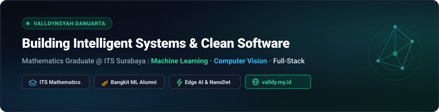

  

  
  &nbsp;
  
  &nbsp;
  

---

### About Me

Hello! I'm **Valldynsyah Danuarta**, a Mathematics graduate from **Institut Teknologi Sepuluh Nopember (ITS)** Surabaya with a strong theoretical and applied focus in **Machine Learning**, **Computer Vision**, and **Full-Stack Engineering**.

- **Education:** B.Sc. in Mathematics from Institut Teknologi Sepuluh Nopember (ITS Surabaya).
- **Specialization:** Computer Vision & Lightweight Edge AI (NanoDet, MobileNetV2, TFLite).
- **Cohort Alumni:** Bangkit Academy 2024 Graduate — Machine Learning Cohort.
- **Systems & Automation:** Automation, Reverse Engineering & Real-Time Protocol Engineering (WebSockets, APIs, scraping).
- **Web Engineering:** Building responsive, high-performance web applications with Next.js, FastAPI, and Tailwind CSS.
- **Location:** Surabaya, Indonesia.

---

### Tech Stack & Arsenal

  

 

| Domain | Technologies & Frameworks |
| :--- | :--- |
| **Languages** | Python, TypeScript, JavaScript, Lua, C++, SQL, Bash |
| **AI, ML & CV** | PyTorch, TensorFlow, Keras, OpenCV, NanoDet, Scikit-Learn, Pandas, NumPy |
| **Web & Backend** | Next.js 15/16, React, FastAPI, Node.js, Tailwind CSS, REST APIs, WebSockets |
| **Cloud & DevOps** | Linux (Ubuntu/Debian), Docker, Git, GitHub Actions, Google Cloud Platform (GCP) |
| **Tools & Creative** | Figma, OBS Studio, Blender, Postman, VS Code |

---

### Featured Highlights

<table>
  <tr>
    <td width="50%" valign="top">
      <h3 align="center">Real-Time Traffic Light Detection</h3>
      
<b>Undergraduate Thesis — ITS Mathematics</b>

      
Lightweight object detection pipeline using <b>NanoDet</b> for real-time traffic light identification under dynamic urban conditions.

      <ul>
        <li><b>&gt;45–60 FPS</b> inference speed on GPU (&gt;25 FPS CPU)</li>
        <li>Ultra-lightweight model footprint (<b>&lt; 4 MB</b>, edge-ready)</li>
        <li><b>92.4%</b> mAP@0.5 detection accuracy</li>
      </ul>
      
<code>Python</code> <code>PyTorch</code> <code>NanoDet</code> <code>OpenCV</code> <code>CUDA</code>

    </td>
    <td width="50%" valign="top">
      <h3 align="center">SkinLens-Care</h3>
      
<b>Bangkit Academy Capstone Project</b>

      
Mobile-first dermatology diagnostic application leveraging deep learning transfer learning for early skin disease classification.

      <ul>
        <li>MobileNetV2 & EfficientNet transfer learning</li>
        <li>Quantized & optimized for <b>TensorFlow Lite</b></li>
        <li>Scalable cloud inference API microservice</li>
      </ul>
      
<code>Python</code> <code>TensorFlow</code> <code>TFLite</code> <code>FastAPI</code> <code>GCP</code>

    </td>
  </tr>
  <tr>
    <td width="50%" valign="top">
      <h3 align="center">E-Commerce Public Dataset Analysis</h3>
      
<b>Exploratory Data Analysis</b>

      
End-to-end exploratory data analysis (EDA) on the Olist Brazilian E-Commerce public dataset to identify transaction patterns, product performance, and customer behavior.

      
<code>Python</code> <code>Pandas</code> <code>Matplotlib</code> <code>Seaborn</code>

    </td>
    <td width="50%" valign="top">
      <h3 align="center">Forecasting USD/IDR Exchange Rate Movements</h3>
      
<b>Independent Research — Deep Learning</b>

      
Independent research on forecasting USD to IDR currency exchange rate movements using a Stacked Long Short-Term Memory (LSTM) architecture based on 10 years of historical data (2014–2024).

      
<code>Python</code> <code>TensorFlow</code> <code>Keras</code> <code>LSTM</code>

    </td>
  </tr>
  <tr>
    <td width="50%" valign="top">
      <h3 align="center">Hoshi – Multi-Platform Live Stream Companion & Automation Suite</h3>
      
<b>Desktop Companion & Automation Suite</b>

      
An advanced multi-platform live streaming desktop companion and real-time automation hub integrating TikTok Live, YouTube Live, and Twitch into a centralized dashboard with custom OBS browser overlays, interactive widgets, TTS synthesizer, music requests with synced lyrics, and a built-in queue manager for community mabar game sessions.

      
<code>Node.js</code> <code>Express</code> <code>Socket.IO</code> <code>Electron</code>

    </td>
    <td width="50%" valign="top">
      <h3 align="center">Explore All Projects</h3>
      
<b>Portfolio — valldy.my.id</b>

      
Browse the complete project gallery with details, tech stacks, and demos on my live portfolio site.

      
<a href="https://www.valldy.my.id/"><b>Visit valldy.my.id &rarr;</b></a>

      
<code>5 Projects</code> <code>Live Portfolio</code>

    </td>
  </tr>
</table>

---

### Let's Connect

  
  &nbsp;
  
  &nbsp;
  

  <i>"Truth-seekers of knowledge, engineering solutions through mathematics and code."</i>

